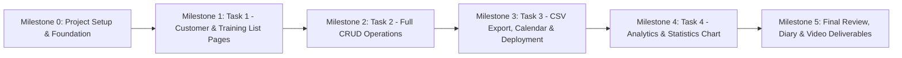

# PLAN.md - Active Sprint Backlog & Roadmap

## 🚦 Strict Working Agreement (The Approval Gate)

- **Rule 1:** Never write or modify application code without checking `PLAN.md` first.
- **Rule 2:** Execute **exactly ONE** numbered task at a time.
- **Rule 3:** After completing a task:
  - Run verification (`npm run build` and `npm run lint`).
  - Mark the checkbox as completed (`[x]`).
  - Provide a clear summary of changes in the chat.
  - **STOP and WAIT for explicit user approval** before proceeding to the next task.
- **Rule 4:** Keep `README.md`, `AGENT.md`, `PROJECT_SPEC.md`, and `PLAN.md` in sync.

---

## 🎯 Current Status

- **Active Milestone:** Milestone 2 - Task 2: Customer & Training CRUD Operations
- **Current Task:** Completed Milestone 0 & Milestone 1 (Task 1). Waiting for user approval to proceed to Task 2.1 (Implement Reusable Confirmation Dialog & Feedback Notifications for CRUD).

---

## 🗺️ Milestone Roadmap

---

## 📦 Milestone 0: Project Setup & Foundation

- [x] **Task 0.1: Establish 4-document Agile workflow**
  - Analyze repository structure, tech stack, and API docs.
  - Generate/update `README.md`, `AGENT.md`, `PROJECT_SPEC.md`, and `PLAN.md`.
  - Establish the strict Approval Gate.
- [x] **Task 0.2: Configure core dependencies & React 19 compatibility**
  - Install and verify UI framework (Material UI / Emotion or AG Grid), Day.js, and essential utility libraries.
  - Validate clean `npm run build` and `npm run lint`.
- [x] **Task 0.3: Setup base architecture, TypeScript types & API client**
  - Create directory structure (`src/types`, `src/services`, `src/components`, `src/pages`, `src/utils`).
  - Implement domain models (`Customer`, `Training`, `TrainingWithCustomer`, DTOs).
  - Implement `api.ts` client with base URL configuration and reset DB helper.
- [x] **Task 0.4: Build layout shell & responsive navigation**
  - Create navigation bar with tabs/links (`Customers`, `Trainings`, `Calendar`, `Statistics`).
  - Include "Reset Demo Database" action button with confirmation in the navbar/settings.
  - Setup routing or view switcher.

---

## 📋 Milestone 1: Task 1 - Customer & Training List Pages

- [x] **Task 1.1: Implement Customer List Page**
  - Fetch customers using `customerService.getCustomers()`.
  - Render sortable, filterable table/grid with columns: First Name, Last Name, Street Address, Postcode, City, Email, Phone.
  - Include search/filter input and loading state.
- [x] **Task 1.2: Implement Training List Page with Formatted Date & Customer Name**
  - Fetch trainings using `trainingService.getTrainingsWithCustomer()` (via `/gettrainings`).
  - Display table with columns: Activity, Duration (min), Formatted Date (`DD.MM.YYYY HH:mm`), Customer Name (`Firstname Lastname`).
  - Implement sorting, searching, and filtering on activity and customer name.
- [x] **Task 1.3: Milestone 1 Verification & Polish**
  - Verify sorting, filtering, and responsive behavior for both list pages.
  - Run lint and build checks.
  - Capture verification screenshots for Task 1 assignment submission.

---

## ⚡ Milestone 2: Task 2 - Customer & Training CRUD Operations

- [ ] **Task 2.1: Implement Reusable Confirmation Dialog & Feedback Notifications**
  - Create generic `ConfirmDialog` component (Yes / Cancel).
  - Create snackbar alert notification system for success and error messages.
- [ ] **Task 2.2: Add Customer Functionality**
  - Create `AddCustomerDialog` form modal with fields: firstname, lastname, email, phone, streetaddress, postcode, city.
  - Handle form validation, POST request to `/customers`, state refresh, and success notification.
- [ ] **Task 2.3: Edit Customer Functionality**
  - Create `EditCustomerDialog` pre-filled with selected customer data.
  - Handle PUT request to customer self href / ID, state refresh, and notification.
- [ ] **Task 2.4: Delete Customer Functionality with Confirmation**
  - Add delete action button to customer row.
  - Trigger `ConfirmDialog` before deletion ("Are you sure you want to delete this customer? All associated training sessions will also be deleted.").
  - Handle DELETE request, handle 204 response, refresh list, and notify user.
- [ ] **Task 2.5: Add Training to Customer with Date-Time Picker**
  - Create `AddTrainingDialog` modal.
  - Include Date-Time Picker component, activity input, duration input, and customer selection.
  - Handle POST request to `/trainings` with ISO-8601 formatted date and customer link.
- [ ] **Task 2.6: Delete Training Functionality with Confirmation**
  - Add delete action button to training row.
  - Trigger `ConfirmDialog` before deletion.
  - Handle DELETE request to `/trainings/{id}`, refresh list, and notify user.
- [ ] **Task 2.7: Milestone 2 Verification & Polish**
  - Test all CRUD flows end-to-end.
  - Run lint and build checks.
  - Capture verification screenshots for Task 2 assignment submission.

---

## 📅 Milestone 3: Task 3 - Customer CSV Export, Calendar & Deployment

- [ ] **Task 3.1: Implement Customer CSV Export**
  - Create export utility that extracts customer data excluding action columns, internal links, or IDs.
  - Add "Export to CSV" button on the Customers page.
  - Validate output CSV file formatting and data accuracy.
- [ ] **Task 3.2: Implement Training Calendar Page**
  - Build `CalendarPage` component integrated with calendar library.
  - Map training sessions to calendar events (title: `Activity / Customer Name`, start time, end time computed from duration).
  - Implement Month, Week, and Day views with intuitive navigation (prev, next, today).
- [ ] **Task 3.3: Calendar Event Details & Inspection**
  - Add interactive event modal or popover showing full session info (Customer, Phone, Email, Activity, Duration, Date).
- [ ] **Task 3.4: Cloud Deployment Setup & Verification**
  - Configure production build settings for cloud deployment (e.g. Vercel, Netlify, or GitHub Pages).
  - Deploy application to cloud hosting and verify live API connectivity.
  - Document live deployment URL in `README.md`.
  - Capture verification screenshots for Task 3 assignment submission.

---

## 📊 Milestone 4: Task 4 - Workout Analytics & Statistics Chart

- [ ] **Task 4.1: Data Aggregation Engine**
  - Create analytics utility function using Lodash (`groupBy`, `sumBy`) to aggregate training durations by activity.
  - Structure data for chart visualization (`[{ activity: "Spinning", duration: 180 }, ...]`).
- [ ] **Task 4.2: Implement Statistics Dashboard with Bar Chart**
  - Create `StatisticsPage` featuring responsive bar chart (using Recharts).
  - Label axes clearly (Activity vs. Total Minutes).
  - Add summary stat cards (Total Training Minutes, Total Sessions, Most Frequent Activity).
- [ ] **Task 4.3: Milestone 4 Verification & Polish**
  - Verify chart calculations against raw API data.
  - Run lint and build checks.
  - Capture verification screenshots for Task 4 assignment submission.

---

## 🏆 Milestone 5: Final Review, Learning Diary & Presentation Deliverables

- [ ] **Task 5.1: End-to-End Application QA & Performance Audit**
  - Comprehensive testing across all pages and edge cases (including empty database handling).
  - Confirm zero console errors, zero warnings, and clean responsive layout.
- [ ] **Task 5.2: Documentation & Repository Finalization**
  - Update `README.md` with final screenshots, live links, and full instructions.
  - Finalize `PROJECT_SPEC.md` and `PLAN.md`.
- [ ] **Task 5.3: Learning Diary Preparation Assistance**
  - Compile structured summary of development phases, architectural choices, and technical challenges for the mandatory assignment diary.
- [ ] **Task 5.4: Video Presentation Outline & Script**
  - Prepare demonstration script covering all required assignment criteria for the video submission.

