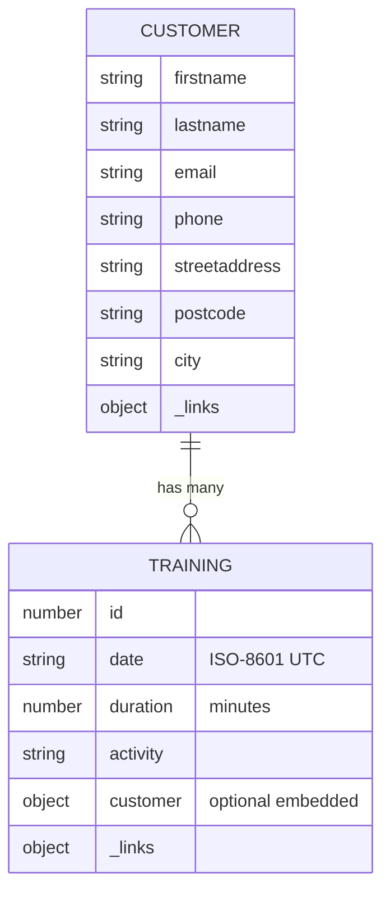

# PROJECT_SPEC.md - Master Product Backlog & System Blueprint

## 📖 Executive Summary & Product Vision

The **Personal Trainer Front-End Application** is a specialized management portal designed for fitness professionals and personal training businesses. The application bridges the gap between client record management and training scheduling, empowering trainers to:
- Browse, search, filter, and organize client records.
- Track completed and upcoming training workouts with precise timestamps.
- Manage full lifecycle records (Create, Read, Update, Delete) for customers and workout sessions.
- Export clean customer data in standard CSV format for external CRM/accounting tools.
- Visualize training schedules in an intuitive multi-view calendar (month, week, day).
- Gain actionable insights through visual charts analyzing total training volume across activity types.

---

## 🎯 Target Evaluation & Grading Criteria (Grade 5)

| Criteria | Standard for Maximum Grade (5) |
| :--- | :--- |
| **Completeness** | Full completion and verification of all 4 Tasks (Part 1, Part 2, Part 3, and Part 4). |
| **Code Quality** | Strict TypeScript adherence, modular architecture, descriptive naming, clean file structure, and zero ESLint/TypeScript compile warnings. |
| **UX & UI Design** | Intuitive, responsive, polished user interface with clear typography, loading states, and confirmation dialogs for destructive actions. |
| **Date & Time Formatting** | Consistently formatted dates (`DD.MM.YYYY HH:mm` / `dd.mm.yyyy hh:mm`) using Day.js. |
| **Schedule & Submission** | Timely completion, comprehensive learning diary, demonstration video presentation, and active cloud deployment link. |

---

## 🗄️ Domain Model & Entity Relationship (ER)



### Relationship Details:
- **One-to-Many:** One Customer can have zero or more Training sessions. Each Training session belongs to exactly one Customer.
- **Cascade Deletion:** Deleting a Customer at the REST API level automatically cascades and removes all associated Training sessions.

---

## 📑 Data Contracts & TypeScript Definitions

### 1. Customer Types

```typescript
export interface CustomerLinks {
  self: { href: string };
  customer: { href: string };
  trainings: { href: string };
}

export interface Customer {
  firstname: string;
  lastname: string;
  email: string;
  phone: string;
  streetaddress: string;
  postcode: string;
  city: string;
  _links: CustomerLinks;
}

export interface CustomerFormData {
  firstname: string;
  lastname: string;
  email: string;
  phone: string;
  streetaddress: string;
  postcode: string;
  city: string;
}

export interface CustomerListResponse {
  _embedded: {
    customers: Customer[];
  };
}
```

### 2. Training Types

```typescript
export interface TrainingLinks {
  self: { href: string };
  training: { href: string };
  customer: { href: string };
}

export interface TrainingRaw {
  id?: number;
  date: string; // ISO-8601 string: e.g. "2024-04-18T18:59:46.350+00:00"
  duration: number; // in minutes
  activity: string;
  _links?: TrainingLinks;
}

export interface CustomerSummary {
  id: number;
  firstname: string;
  lastname: string;
  streetaddress: string;
  postcode: string;
  city: string;
  email: string;
  phone: string;
}

export interface TrainingWithCustomer {
  id: number;
  date: string;
  duration: number;
  activity: string;
  customer: CustomerSummary | null;
}

export interface NewTrainingPayload {
  date: string; // ISO-8601 string
  activity: string;
  duration: number;
  customer: string; // Customer self href link
}
```

---

## 🌐 REST API Specifications

- **Base URL:** `https://customer-rest-service-frontend-personaltrainer.2.rahtiapp.fi/api/`
- **Database Reset:** `POST https://customer-rest-service-frontend-personaltrainer.2.rahtiapp.fi/reset`
- **Documentation:** `https://juhahinkula.github.io/personaltrainerdocs/`

### Endpoint Catalog:

| Method | Endpoint | Description | Request Body | Response Status & Body |
| :--- | :--- | :--- | :--- | :--- |
| `POST` | `/reset` *(Root level)* | Resets database to sample seed data | None | `200 OK` ("DB reset done") |
| `GET` | `/customers` | Fetch all customers | None | `200 OK` (`{ _embedded: { customers: [...] } }`) |
| `GET` | `/customers/{id}` | Fetch single customer | None | `200 OK` (`Customer`) |
| `POST` | `/customers` | Create new customer | `CustomerFormData` | `201 Created` (`Customer`) |
| `PUT` | `/customers/{id}` *(or self href)* | Update existing customer | `CustomerFormData` | `200 OK` (`Customer`) |
| `DELETE` | `/customers/{id}` *(or self href)* | Delete customer & associated trainings | None | `204 No Content` / `404` |
| `GET` | `/trainings` | Fetch raw trainings (HATEOAS) | None | `200 OK` (`{ _embedded: { trainings: [...] } }`) |
| `GET` | `/gettrainings` | Fetch all trainings with embedded customer details | None | `200 OK` (`TrainingWithCustomer[]`) |
| `POST` | `/trainings` | Create new training linked to a customer | `NewTrainingPayload` | `201 Created` (`TrainingRaw`) |
| `DELETE` | `/trainings/{id}` | Delete training session | None | `204 No Content` / `404` |

---

## 🚀 Prioritized Epics & User Stories

### Epic 1: Navigation & List Views (Task 1)
- **Story 1.1:** As a personal trainer, I want a persistent top navigation bar so that I can easily switch between Customers and Trainings.
- **Story 1.2:** As a trainer, I want to view a table of all customers with sorting and filtering on any column (name, email, phone, address).
- **Story 1.3:** As a trainer, I want to view a table of all training sessions displaying the customer's full name, activity, duration, and formatted date (`DD.MM.YYYY HH:mm`).
- **Story 1.4:** As a trainer, I want to search and filter trainings by customer name, activity, or date.

### Epic 2: Customer & Training CRUD Operations (Task 2)
- **Story 2.1:** As a trainer, I want to add a new customer via a clean dialog form with validation.
- **Story 2.2:** As a trainer, I want to edit an existing customer's contact and address details.
- **Story 2.3:** As a trainer, I want to delete a customer with a mandatory confirmation modal ("Are you sure you want to delete this customer and all their sessions?").
- **Story 2.4:** As a trainer, I want to schedule a new training session for a customer using an intuitive date-time picker.
- **Story 2.5:** As a trainer, I want to delete a training session with a confirmation modal.
- **Story 2.6:** As a trainer, I want clear visual notifications (success/error alerts) whenever an entity is created, edited, or deleted.

### Epic 3: Customer Data Export, Calendar Schedule & Cloud Deployment (Task 3)
- **Story 3.1:** As a trainer, I want to export customer records to a CSV file, ensuring action buttons, links, and sensitive IDs are excluded.
- **Story 3.2:** As a trainer, I want an interactive calendar view displaying all training sessions across Month, Week, and Day views.
- **Story 3.3:** As a trainer, I want to click or hover over a calendar event to inspect customer details, activity, and duration.
- **Story 3.4:** As an evaluator/trainer, I want the web application deployed live on a reliable cloud hosting provider (e.g. Vercel, Netlify, or GitHub Pages) for public access.

### Epic 4: Workout Analytics & Statistics Dashboard (Task 4)
- **Story 4.1:** As a trainer, I want a dedicated statistics dashboard summarizing overall training activity.
- **Story 4.2:** As a trainer, I want to see a clear bar chart showing the total duration (sum of minutes) categorized by workout activity (e.g. Spinning, Gym, Zumba, Jogging).
- **Story 4.3:** As a trainer, I want aggregated metrics (e.g., total workouts, total training hours, most popular activity).

### Epic 5: Final Quality Polish, Documentation & Submission Deliverables
- **Story 5.1:** As a student, I want to complete the mandatory learning diary documenting my development process, choices, and lessons learned.
- **Story 5.2:** As an evaluator, I want a video presentation walking through all application features and code architecture.
- **Story 5.3:** As a developer, I want all code linted and formatted with complete README instructions and working repository links.

---

## 🛡️ Edge Cases & Architectural Decisions

1. **Empty Database Handling:**
   - If the database is empty or has been wiped, provide an in-app "Reset Database" utility button that calls `POST /reset` and restores demo records immediately.
2. **Date Timezone & Formatting:**
   - The API stores ISO strings with UTC offset (e.g., `2024-04-18T18:59:46.350+00:00`). Day.js will be configured to format them locally into `DD.MM.YYYY HH:mm`.
3. **Training Customer Association:**
   - When creating a training, the API requires the customer's self-link URL (e.g. `https://.../api/customers/123`). The add-training form will provide a searchable customer dropdown that populates this link automatically.
4. **Data Grid Performance & React 19 Compatibility:**
   - Ensure the chosen data grid / UI component suite supports React 19 without dependency peer conflicts.

